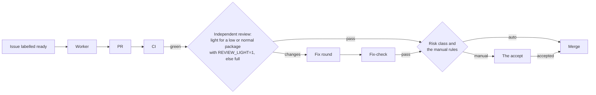
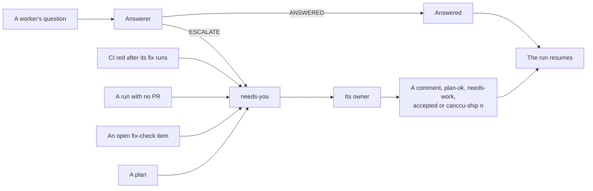
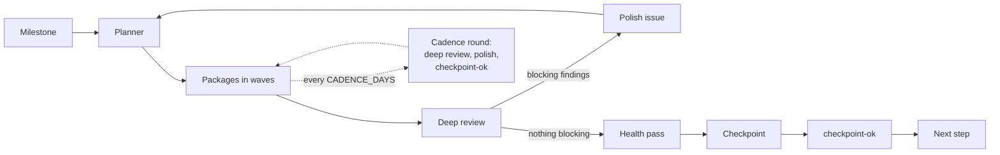

<!-- SPDX-License-Identifier: AGPL-3.0-or-later -->
# How it works

The dispatcher runs on your Linux host and moves GitHub issues to merged PRs: a worker writes
the change, an independent reviewer checks it, CI runs, and the PR merges or waits for you. It
runs with or without a **leader**, a Claude session that clears the technical items for you. To
set it up, follow [`getting-started.md`](getting-started.md); every detail is in the
[reference](reference/README.md).

## One issue

- **Issue labelled `ready`**: each pass starts the first runnable issue under the run caps, in
  milestone and epic order ([`reference/pipeline.md`](reference/pipeline.md#one-pass), step 3).
- **Worker**: a Claude session in its own worktree and branch `<n>-<slug>`, told to work test
  first and stop once its PR is open ([`reference/reviews.md`](reference/reviews.md#worker-prompt)).
- **PR**: one per issue, or one per work package of a step, with `Closes`, `Tier:` and
  `Decisions made:` lines (a package's also `Package:` and `Risk:`)
  ([`reference/packages.md`](reference/packages.md#package-runs)).
- **CI**: red CI gets main merged in by script, a rerun and up to `FIX_ATTEMPTS` fix runs before
  it needs someone ([`reference/pipeline.md`](reference/pipeline.md#one-pass), step 2).
- **Independent review**: a fresh session that only reads; a low or normal package gets the light
  checklist at low effort, anything else the full review
  ([`reference/review-depth.md`](reference/review-depth.md#the-light-review),
  [`reference/reviews.md`](reference/reviews.md#reviewer)).
- **Fix round**: a `changes` verdict sends the worker back once with the blocking findings; the
  rest go to a follow-up ticket
  ([`reference/review-depth.md`](reference/review-depth.md#one-full-review-per-pr-cycle)).
- **Fix-check**: a narrow check of the fix diff against those findings, never a second full
  review ([`reference/reviews.md`](reference/reviews.md#fix-check)).
- **Risk class and the manual rules**: high risk, a gated path, agent configuration, a path
  users see (`USER_VISIBLE_PATHS`), a `manual-accept` label or `AUTO_MERGE_UNTIL` make a PR wait
  for an accept
  ([`reference/packages.md`](reference/packages.md#risk-classes),
  [`reference/merging.md`](reference/merging.md#merge-policy)).
- **Merge**: auto-merge pinned to the reviewed head, then the issue is closed out and its
  worktree removed ([`reference/merging.md`](reference/merging.md#merge-policy)).
- **The accept**: the PR is labelled `awaiting-accept` and waits for `accepted` or
  `canccu-ship <n>` from its owner ([`reference/merging.md`](reference/merging.md#the-accept-channels)).

## When it needs someone

- **A worker's question**: a worker that cannot go on stops with a `Question:` line
  ([`reference/reviews.md`](reference/reviews.md#worker-prompt)).
- **Answerer**: a fresh session answers from the issue and the repo's docs, or escalates what
  would change scope, a decision or security ([`reference/reviews.md`](reference/reviews.md#answerer)).
- **Answered**: its `Answer:` comment resumes the worker; you can overrule it from the digest
  ([`reference/pipeline.md`](reference/pipeline.md#one-pass), steps 2 and 7).
- **CI red after its fix runs**, **a run with no PR**, **an open fix-check item** and **a plan**
  of the plan tier label the issue `needs-you` with a comment saying why
  ([`reference/leader.md`](reference/leader.md#what-waits-for-you)).
- **Its owner**: the product owner, or the leader for the items the owner rule gives it
  ([`reference/leader.md`](reference/leader.md#the-owner-of-a-waiting-item)); yours ping your
  phone ([`reference/pings.md`](reference/pings.md#pings)).
- **The answer**: a comment, `plan-ok`, `needs-work`, `accepted` or `canccu-ship <n>`, as the
  item's line says ([`reference/leader.md`](reference/leader.md#what-waits-for-you)).
- **The run resumes**: the next pass hands the answer to the worker (a fresh session from its
  handoff, unless `RESUME_ON` names the kind), or arms the merge
  ([`reference/pipeline.md`](reference/pipeline.md#one-pass), steps 4 and 5).

## Steps

- **Milestone**: a roadmap step is a milestone whose title starts with its number, with an epic
  and optionally a checkpoint issue ([`reference/leader.md`](reference/leader.md#steps-and-epics)).
- **Planner**: a fresh session bundles the step's ready issues into packages; the dispatcher
  checks the plan ([`reference/packages.md`](reference/packages.md#the-planner)).
- **Packages in waves**: each package runs as one unit through [One issue](#one-issue); the next
  wave plans what is left ([`reference/packages.md`](reference/packages.md#waves)).
- **Deep review**: once the step's work issues are closed, one review of the step's whole change
  (`STEP_DEEP_REVIEW=1`) ([`reference/steps.md`](reference/steps.md#deep-review-and-polish)).
- **Polish issue**: its blocking findings as one `ready` issue in the step, planned like any
  other ([`reference/steps.md`](reference/steps.md#deep-review-and-polish)).
- **Health pass**: one package splits big files, removes dead code and fixes comments, with no
  behaviour change ([`reference/steps.md`](reference/steps.md#health-pass)).
- **Checkpoint** and **`checkpoint-ok`**: the step pauses on a summary until the product owner
  labels the checkpoint `checkpoint-ok` or closes it ([`reference/steps.md`](reference/steps.md#checkpoint)).
- **Next step**: the step is done (tagged with `STEP_TAG`), and the next milestone's packages
  start ([`reference/steps.md`](reference/steps.md#the-current-step)).
- **Cadence round**: a milestone with `Cadence: on` gets a deep review, its polish and a
  checkpoint every `CADENCE_DAYS` while its waves go on ([`reference/steps.md`](reference/steps.md#cadence-rounds)).

**Pacing.** A week's usage limit runs out early when the work spends faster than the week goes
by. With `PACE` on (default `cap`), a project more than `PACE_MARGIN` points ahead of the week
is told (`notify`), held to `PACE_CAP` runs over all projects (`cap`), or starts nothing new
while started work finishes (`pause`), until the week catches up; `canccu-status --pace` shows
it ([`reference/usage.md`](reference/usage.md#pacing)).

A new project starts with a planning session: [`kickoff.md`](kickoff.md) is its template, the
step ladder becomes the milestones, and [`gates.md`](gates.md) says what proves each step done.

## Without a leader

`LEADER=off`, the default. Every waiting item is yours: the monitor's NEEDS YOU box lists them
and a ping (or Telegram) tells your phone. The left pane of window `main` is your own `claude`
session, for writing issues and clearing items. You accept each PR that waits, answer what the
answerer escalates, and resume what stopped. Right for a first project, a small repo, or while
you learn what the pipeline asks of you.

## With a leader

`LEADER=on` (`canccu-init --leader <project>`). The left pane runs the leader, a `claude`
session in the project's leader kit. It follows the feed of waiting items and clears those the
owner rule gives it: failed runs, red CI, a fix-check's open items and, with
`LEADER_ACCEPTS=technical`, the accept of a technical PR. It files the deep review's
missing polish, sets the pace, and passes the rest to you in the ask form. It cannot change a
locked setting, merge by hand or read the reviewer token. You decide scope and accept what
users see ([`reference/leader.md`](reference/leader.md)).

| Task | Without a leader | With a leader |
|---|---|---|
| Write issues | You, in your own session | The leader drafts them with you; `ready` once you agree |
| Plan the steps (kickoff) | You, with [`kickoff.md`](kickoff.md) | The leader runs the session with you; you decide |
| Answer an escalated question | You | You |
| Clear a failed run or red CI | You | The leader |
| Accept a technical PR | You | The leader with `LEADER_ACCEPTS=technical`, else you |
| Accept what users see | You | You |
| Accept a gated path | You | You |
| Accept a high-risk PR | You | You; the leader with `LEADER_ACCEPTS_HIGH_RISK=1` too |
| Checkpoint | You | You |
| Change a locked setting | You | You (`config set` refuses the leader) |
| Watch the pace | You, with `canccu-status --pace` (`PACE=cap` acts by itself) | The leader sets `PACE`, `PACE_MARGIN` and `PACE_CAP` |

## Who accepts

The owner of each waiting item, from
[`reference/leader.md`](reference/leader.md#the-owner-of-a-waiting-item) ("The owner of a
waiting item"); `po` is you, the product owner. `LEADER_ACCEPTS_HIGH_RISK=1` counts only with
`LEADER_ACCEPTS=technical`.

| `LEADER` and its settings | A technical PR that waits | High risk | Users see it, gated path or agent config | An escalated question, a checkpoint, an invalid plan, the step budget |
|---|---|---|---|---|
| `LEADER=off` | po | po | po | po |
| `on`, `LEADER_ACCEPTS=none` | po | po | po | po |
| `on`, `LEADER_ACCEPTS=technical` | leader | po | po | po |
| `on`, `technical`, `LEADER_ACCEPTS_HIGH_RISK=1` | leader | leader | po | po |

A review's `Maintainer accept:` line and a `manual-accept` label make an accept yours in every
row. An item of the leader's that the leader does not acknowledge within 60 minutes of its feed
line passes to the product owner, with a `handover` line, and pings you like any of yours.
